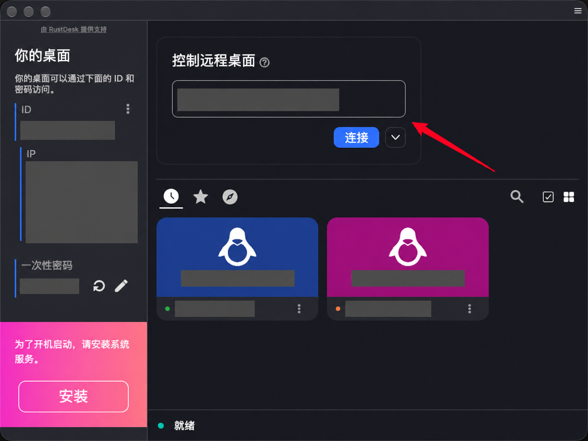
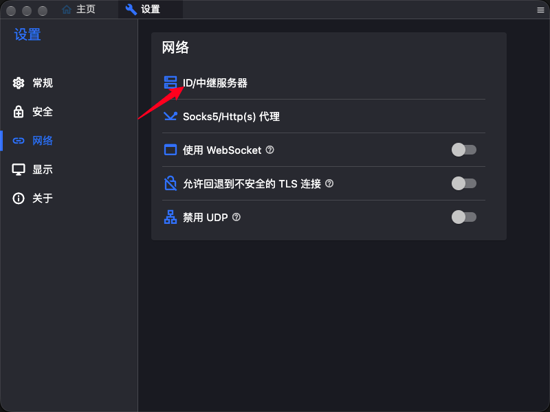
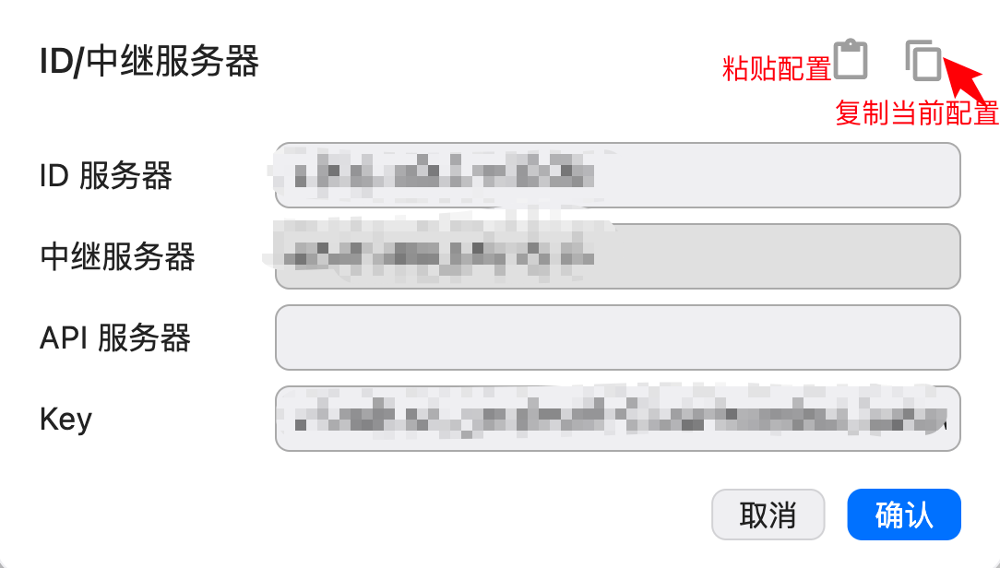

# LanternDesk · 灯塔桌面

LanternDesk 是基于 [RustDesk](https://github.com/rustdesk/rustdesk) 的远程桌面项目，**无需注册或登录账号**，仅使用以下两种连接方式：

- **IP 直连**：通过被控电脑可达的 IP 地址连接，无需部署服务器，适合局域网或已有 VPN 的环境。
- **自部署 ID／中继服务器**：两端配置同一套自建服务器后，通过设备 ID 连接；直接连接失败时使用自建中继转发。

本项目不使用或回退到 RustDesk 公共 ID／中继服务器。远程访问仍需密码验证或被控端确认。

[下载 Release](https://github.com/Cbetula/lanterndesk/releases) · [一行命令部署服务器](#一行命令部署服务器) · [客户端使用教程](#客户端使用教程)

## 下载与编译平台

目前仅在以下环境编译过，其他系统版本和架构暂未验证：

| 系统 | 架构 | 安装包 |
| --- | --- | --- |
| Linux · Ubuntu 24.04 | x86_64 | [Linux 压缩包](https://github.com/Cbetula/lanterndesk/releases/download/lanterndesk-v0.1.2/lanterndesk-v0.1.2-linux-x86_64.tar.gz) |
| macOS 27 | ARM64 · Apple Silicon | [macOS DMG](https://github.com/Cbetula/lanterndesk/releases/download/lanterndesk-v0.1.2/lanterndesk-macos-arm64.dmg) |

上表链接对应 **v0.1.2**。后续版本请查看 [最新 Release](https://github.com/Cbetula/lanterndesk/releases/latest)。

### Linux

下载压缩包后，在下载目录执行：

```bash
tar -xzf lanterndesk-v0.1.2-linux-x86_64.tar.gz
cd lanterndesk-linux-x86_64
./lanterndesk
```

请保留程序旁的 `lib/` 和 `data/` 目录。运行依赖见 [Linux 构建与运行说明](packaging/linux/README.md)。

### macOS

打开 DMG，将 `LanternDesk.app` 拖入“应用程序”后启动。当前安装包使用临时签名，尚未经过 Apple 公证；首次启动如被系统拦截，可在“系统设置 → 隐私与安全性”中允许打开。

作为被控电脑使用时，按提示授予“屏幕与系统音频录制”（或“屏幕录制”）和“辅助功能”权限；键鼠输入仍异常时，按提示检查“输入监控”。权限名称可能随系统版本略有不同，授权后按提示重新启动应用。

## 一行命令部署服务器

在准备作为服务器的 **Debian／Ubuntu Linux** 上执行以下命令。需要已安装 Git、可用的 `sudo` 和 systemd；将 `relay.example.com` 替换为客户端能够访问的服务器 IP 或域名，**不要带协议头或端口**。

```bash
git clone --depth 1 https://github.com/Cbetula/lanterndesk.git lanterndesk-relay-setup && sudo bash lanterndesk-relay-setup/scripts/setup-relay.sh --host relay.example.com
```

此命令用于首次部署，会下载仓库及部署模板。已有仓库时，可在仓库目录直接运行 `sudo bash scripts/setup-relay.sh --host relay.example.com`。

脚本会安装缺少的 Docker／Compose，启动 `hbbs`（ID 服务）和 `hbbr`（中继服务），并保存服务器密钥及客户端配置。默认安装目录为 `/opt/lanterndesk-relay`。服务器防火墙、云安全组及必要的路由端口转发需自行放行 **TCP 21115–21117、UDP 21116**；脚本不会自动修改这些规则。

部署后，在服务器上查看可供客户端导入的配置：

```bash
sudo cat /opt/lanterndesk-relay/client-config.txt
```

复制输出的**完整一行**，按照下方教程导入两端客户端。

[查看部署脚本](scripts/setup-relay.sh) · [完整部署、端口与备份说明](docs/RELAY_ZH.md)

## 客户端使用教程

控制端是发起连接的电脑，被控端是要远程操作的电脑。两端均需安装并运行 LanternDesk。以下截图中的设备 ID、IP、密码、用户名和服务器配置均已遮盖；文字示例使用示例地址，实际操作时请换成自己的配置。

### 方式一：IP 直连

1. 在被控端首页找到左侧 **IP** 栏，选择控制端能够访问的地址。多网卡时可以滚动查看，点击地址即可复制 `IP:端口`。
2. 在控制端右侧“**控制远程桌面**”输入框中粘贴地址，例如 `192.168.1.20:21118`，点击“**连接**”。默认端口为 **TCP 21118**，未修改端口时也可以只填写 IP。
3. 按提示输入被控端显示的一次性密码，或由被控端确认连接，具体取决于被控端的安全设置。



IP 直接访问默认开启。如曾关闭，请在被控端“**设置 → 安全 → 允许 IP 直接访问**”中开启，并检查直连端口。控制端必须能访问被控端的地址和端口；跨公网时，被控端需要可达地址及相应端口转发，也可以改用下方的自建服务器方式。

### 方式二：使用自建 ID／中继服务器

#### 1. 打开服务器设置

点击首页右上角菜单进入“**设置**”，选择“**网络 → ID/中继服务器**”。如显示“解锁网络设置”，请先解锁。



#### 2. 从服务器获取并导入配置

客户端配置来自**你部署的服务器**。上面的部署脚本会在服务器上生成 `/opt/lanterndesk-relay/client-config.txt`，再次查看时运行：

```bash
sudo cat /opt/lanterndesk-relay/client-config.txt
```

将输出的完整一行复制到**当前客户端电脑的剪贴板**，然后在“ID/中继服务器”对话框中：

1. 点击右上角左侧的**剪贴板图标**（下图“粘贴配置”），导入服务器配置。
2. 检查 ID 服务器、中继服务器与 Key 已填入，**API 服务器留空**，点击“**确认**”保存。
3. 在另一端客户端重复导入，确保**控制端和被控端使用同一套服务器配置**。

右侧的**双纸图标**（下图“复制当前配置”）可将当前填写的配置复制到剪贴板，方便在另一台电脑导入；复制后仍需点击“确认”保存本机设置。



#### 3. 需要手动填写时

同目录的 `/opt/lanterndesk-relay/client-config.json` 是可读版本，可以在服务器上查看：

```bash
sudo cat /opt/lanterndesk-relay/client-config.json
```

| 客户端字段 | 配置来源与填写内容 |
| --- | --- |
| ID 服务器 | JSON 中的 `host`，通常为 `relay.example.com:21116` |
| 中继服务器 | JSON 中的 `relay`，通常为 `relay.example.com:21117` |
| API 服务器 | 留空，对应 JSON 中的空 `api` |
| Key | JSON 中的 `key`，即服务器生成的**公钥** |

Key 是部署脚本生成的实际公钥在`/opt/lanterndesk-relay/client-config.json`里能查看。

#### 4. 通过设备 ID 连接

两端保存配置并就绪后，在控制端“控制远程桌面”输入框中输入**被控端的设备 ID**，点击“连接”，再按提示输入密码或由被控端确认。无法建立直接连接时，客户端会通过自建中继服务器转发。

### 密码与常见问题

- **需要固定密码**：在被控端“设置 → 安全 → 密码 → 使用固定密码”中点击“设置固定密码”；两次输入需一致，妥善保存。
- **提示未配置自建服务器**：可继续使用 IP 直连；若要通过设备 ID 连接，请在两端导入服务器配置。
- **IP 连接失败**：确认使用的是被控端可达的 IP、直连已开启，以及被控端防火墙允许实际使用的 TCP 端口（默认 21118）。
- **ID 连接失败**：确认两端 ID 服务器、中继服务器、Key 一致，服务器服务已启动，服务器端口已放行。仅填写中继服务器不能完成设备 ID 注册。
- **Mac 能连上但看不到画面或无法操作**：检查被控端的屏幕录制、辅助功能权限，并按提示重新启动应用。

## 开发与上游

本项目基于 [`rustdesk/rustdesk@53996e3c`](https://github.com/rustdesk/rustdesk/commit/53996e3c404ea5083df0775057e4149e49102084)，保留上游历史、作者归属与版权信息。

[Linux 构建说明](packaging/linux/README.md) · [macOS 构建说明](packaging/macos/README.md) · [已有构建与验证记录](docs/VALIDATION_ZH.md)

本项目沿用上游的 [AGPL-3.0 许可证](LICENCE)。
